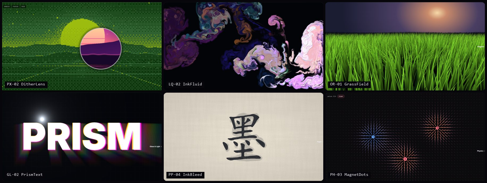

# Claude Motion Lab

Original 3D & UI motion components built from scratch with React, Three.js and GLSL — shown on one long-scroll page, chapter by chapter, from cyberpunk chrome to ink on paper.

**Live demo → [ogurijay.github.io/ClaudeMotionLab](https://ogurijay.github.io/ClaudeMotionLab/)**



## Chapters

Seven visual languages, 38 effects. Every effect is a self-contained React component configured through props, and the page shows its source and props in a built-in viewer.

| Chapter | Effects |
|---|---|
| **CY · Cyber** | `LiquidChrome` liquid-metal shader · `ParticleMorph` 18k morphing particles · `HoloCard` holographic foil cards · `KineticType` variable-font springs · `WaveLines` living ridge-lines · `SpiralGallery` scroll-driven 3D tunnel · `GlitchImage` signal corruption · `HoloScanner` scanning hologram |
| **PX · Pixel** | `DitherLens` Bayer dithering with a full-colour lens · `FallingSand` sand / water / fire sandbox · `CRTScreen` barrel-distorted live DOM with a working terminal · `PixelDissolve` mosaic that resolves from the cursor · `PixelText` Tetris-style block lettering · `PixelTrail` 8-bit spark trails |
| **LQ · Liquid** | `RainGlass` rain on fogged glass over city bokeh · `InkFluid` GPU stable-fluids ink · `GooeyMenu` mercury-like menus · `RipplePond` wave-equation pool with caustics · `BubbleField` thin-film soap bubbles · `LiquidButton` sloshing fill buttons |
| **OR · Organic** | `GrassField` 60k wind-swept blades · `Fireflies` flocking with emergent synchronised flashing · `ReactionDiffusion` Gray–Scott Turing patterns · `GrowingVines` climbing, blooming vines · `AuroraSky` scroll-linked northern lights |
| **PP · Paper** | `PageCurl` cylinder page turns · `InkBleed` calligraphy soaking into xuan paper · `ScribbleUnderline` hand-drawn annotations · `OrigamiFold` letter-fold panels · `TornReveal` rip-away kraft paper |
| **GL · Glass & Light** | `RefractionLens` refractive glass with dispersion · `PrismText` spectral light splitting · `GodRays` volumetric light through lettering · `SpotlightReveal` flashlight in the dark |
| **PH · Physics** | `JellyCard` shape-matching soft body · `ClothBanner` Verlet cloth in the wind · `MagnetDots` iron filings in a multi-pole field · `GravityPile` throwable rigid-body tags |

Each chapter opens with its own transition — RGB interference, a dissolving pixel wall, a draining flood, sprouting vines, folding paper, a light sweep, falling blocks. The full catalog is in [docs/EFFECTS.md](docs/EFFECTS.md).

## Under the hood

- **Lazy mounting** keeps at most a handful of WebGL contexts alive while you scroll the ~45 000 px page (peak 4, budget 6)
- **`useShaderCanvas`** — shared hook for full-screen fragment shaders: DPR caps, smoothed pointer, offscreen pause, reduced motion, text textures with mipmaps
- **`glsim`** — tiny WebGL2 toolkit for multi-pass GPU simulations (fluids, reaction–diffusion)
- **Registry-driven page** — chapters, demos and "coming soon" cards are generated from one file
- **Source viewer** — props parsed straight from each component's signature, highlighted source, copy button
- Touch-friendly scrolling, lighter workloads on small screens, `prefers-reduced-motion` support

## Getting started

```bash
npm install
npm run dev
```

| Script | |
|---|---|
| `npm run dev` | dev server |
| `npm run build` | production build to `dist/` |
| `npm run preview` | preview the production build |

Pushing to `main` deploys to GitHub Pages via [.github/workflows/deploy.yml](.github/workflows/deploy.yml).

## Project structure

```
src/
├── main.jsx          entry
├── app/              showcase shell: registry, chapters, nav, lazy mounting, source viewer, transitions
├── effects/          reusable effect components, one folder per chapter
│   ├── cyber/  pixel/  liquid/  organic/  paper/  glass/  physics/
├── hooks/            useShaderCanvas, useVisibility, useReducedMotion
├── lib/              glsim (multi-pass GPU simulations), artwork (procedural image sources)
└── styles/           global + showcase styles
docs/                 project documentation (Chinese)
```

## Documentation

| Doc | Contents |
|---|---|
| [docs/ROADMAP.md](docs/ROADMAP.md) | Phases, tasks, acceptance criteria, decision log |
| [docs/EFFECTS.md](docs/EFFECTS.md) | Every effect: ID, chapter, description, interaction, tech, batch, status |
| [docs/ARCHITECTURE.md](docs/ARCHITECTURE.md) | Stack, layout, rendering approaches, WebGL budget, registry, shared hooks |
| [docs/CONVENTIONS.md](docs/CONVENTIONS.md) | Naming, component contract, GLSL, commits, Definition of Done |
| [CHANGELOG.md](CHANGELOG.md) | Release notes |

## License

[PolyForm Noncommercial License 1.0.0](LICENSE.md) — free to use, modify and share for **noncommercial** purposes. Commercial use is not permitted.

Required Notice: Copyright (c) 2026 Ogurijay (https://github.com/Ogurijay)
